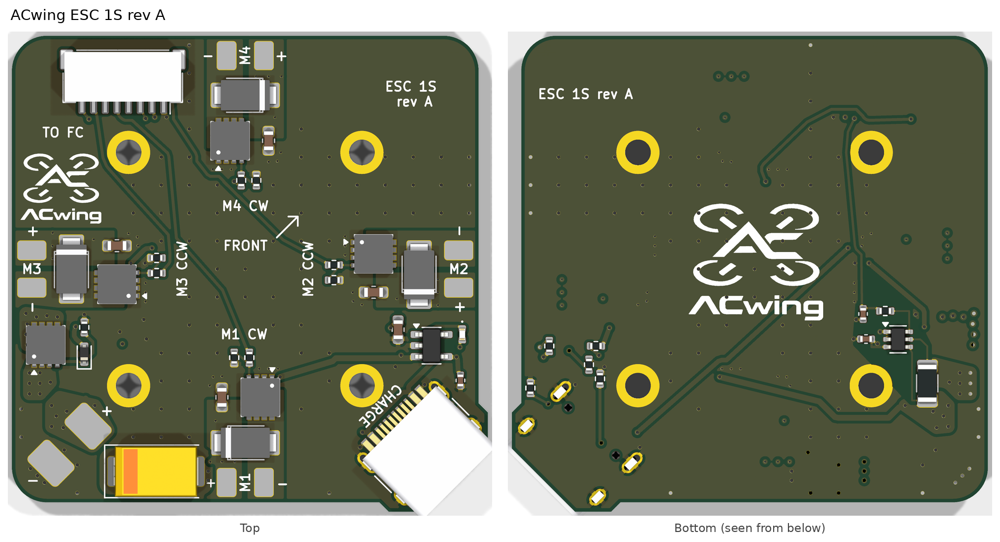

# ACwing ESC 1S rev A – 1S brushed power board for ACwing FC rev A

**Project:** ACwing · **Author:** Andrea Cirillo · **Overview:** [repository README](../../Readme.md)



> **Revisions.** Rev A is the first released revision. The earlier letter, marked *draft* in this document (draft A, the first motor board), is an internal design iteration that was never manufactured.

> **Layout update 2 (2026-11-07 evening, still rev A).** With FC ESC A moved to the front-left corner:
> - **USB-C J4 and the charger** (U2, C8, C9, D6, R12–R16) moved to the **rear-right corner**, mouth at the rear-right
>   chamfer, right under the FC USB-C (point reflection of the old group: J4 centre (+15.77, −15.77), axis at 45°).
>   The rear-right corner gets the same 0.8 mm step outline as the FC. The two USB-C plugs cannot be mated at the same
>   time (≈ 0.5 mm overlap of the overmolds); either one alone fits.
> - The **front-left corner is R3 again** (the charge-port chamfer is gone).
> - **J1 ESC link on the front edge, just after the front-left corner arc**: centre **(−10.5, +16.08)**, mouth +v,
>   pins u = −7.0 (pin 1) … −14.0, v = +14.08; body u −16.4 … −4.6, 0.6 mm from the end of the R3 arc (u −17).
>   FC J2 sits right above it (same u): cable A is a short, straight 1:1 loop. J1 is 2.8 mm closer to the front-edge
>   centre than the mirror of the previous place: the frame has to check the front-left guard ring again (handoff §0.19).
> - "TO FC" label under the left end of J1, logo at the front-left, "ESC 1S rev A" in the front-right quadrant.
> - **Board 1.0 mm again** (JLC04101H-7628), as all ACwing boards. DRC 0 / 0, no via in pads.

> **J1 toward the front corner (2026-11-07, still rev A; superseded by layout update 2).** Answer to the frame A1 handoff (§10, front-left guard ring
> above J1): **J1 moved 3.7 mm toward the front corner and 0.8 mm inward**: centre **(+13.3, +16.08)**, mouth +v, pins
> u = +16.8 (pin 1) … +9.8, v = +14.08. Limits: the R3 corner (mounting pad ≥ 0.3 mm from the edge, with 0.2 mm spare)
> and the +10, +10 grommet (0.31 mm in the stack check). The end of the mated plug nearest the motor axis moves ≈ 1.6 mm
> further from the guard ring (estimate; the frame checks confirm it). FC J2 → ESC J1 offset 9.7 mm (was 6).
> PWM_M1–M4, CUR and the J1 GND / VBAT stubs re-routed; 3 GND stitching vias under the new J1 position removed; "TO FC"
> label moved right of the grommet. DRC 0 / 0, no via in pads, stack check with all plugs mated: no clash.

> **1.6 mm boards (2026-11-07, still rev A).** All ACwing boards are now **1.6 mm** thick (were 1.0 mm), KiCad 10 files. Stack-up JLC04161H-7628 in the board file; In1 GND / In2 VBAT planes unchanged. Vias 0.5 / 0.3, 0.6 / 0.3 and
> 0.45 / 0.2 mm, all standard at 1.6 mm. The FC sits 0.6 mm higher (grommet gap unchanged, 5 mm). Board mass +1.8 g.
> **No via in any SMD pad** (checked again with KiCad 10). DRC 0 / 0.

> **Stack update (2026-11-06, still rev A).** **J1 ESC link moved from the rear edge to the front edge**, under FC J2:
> centre (+9.6, +16.88), mouth +v, pin 1 at the +u end (pins u = +13.1 … +6.1), as FC J2 (pins u = +7.14 … +0.14).
> The FC → ESC cable becomes a short 1:1 U-loop on the front edge (≈ 25–30 mm) instead of running around the stack.
> J1 sits 6 mm east of FC J2 because the M4 motor pads and D4 hold the front-edge centre. PWM_M1–M4, CUR, the GND / VBAT
> stubs of J1 re-routed (CUR on F.Cu / B.Cu, 0.2 mm, away from the motor stages); 15 GND stitching vias under the
> connector removed; logo moved to the rear-right corner, "TO FC" label under J1. DRC 0 / 0, no via in pads; stack check
> with all plugs mated: no clash (J1 under the FC bottom parts with 1.1 mm margin, as before at the rear).

KiCad 10 project (2026-11-07). The power board of the 1S mini drone: battery entry, current sensor,
four brushed motor stages, and (new in rev A) a **USB-C charge port with a 1S charger**. To the FC it looks like any
4-in-1 ESC: VBAT (1S) and CUR on the standard JST SH 8-pin cable. On larger drones a commercial 4-in-1 ESC replaces
this board on the same cable.

## Changes from draft A
| Item | Rev A | Why |
|---|---|---|
| **Charge port (new)** | J4 USB-C (HRO TYPE-C-31-M-12), power only, CC1/CC2 5.1 k (R12/R13), C8 1 µF; top side, **45° at the rear-right chamfer**, under the FC USB-C (front-left chamfer until 2026-11-07) | charging moves off the FC; the edges are full (motor stages at the midpoints, holes at ±10), the corners are the only free edge spots |
| **1S charger (new)** | U2 STC4054GR, 4.2 V, **455 mA** (R14 2.2 k); D6 green LED (on = charging) + R15; R16 1 Ω + C9 4.7 µF on BAT; BAT straight to the battery terminal | ≈ 1C for a 450 mAh pack; thermal regulation in the IC |
| **Charge switch (new)** | Q5 AON7423 P-MOSFET (20 V, 4.9 mΩ @ −2.5 V) between the shunt and VBAT; R11 100 k gate pull-down (on), D5 RB521S30 from VBUS lifts the gate (off) | with USB plugged in, FC and motors are unpowered: no motor can spin while charging, and the charger terminates on the battery current alone |
| Current sensor | R9 2 mΩ + U1 TSC213 as draft A; the sensed node is now VBAT_SH (battery → R9 → Q5 → VBAT); U1 supplied from VBAT | charge current does not pass R9 (CUR reads 0 while charging) |
| Battery connection | J2 solder pads as draft A + a **JST PH 2.0 pigtail** soldered to them (BoM item, not assembled) | a board-mounted PH 2.0 does not fit: 9 mm deep against 7.3 mm between the holes and the edges (checked at every edge and corner) |
| Outline | preliminary-draft frame outline (40 × 40, R3) with the rear-right chamfer u − v = 36.2 and 0.8 mm steps at the edges, as the FC (front-left until 2026-11-07) | charge port |

Unchanged: motor stages Q1–Q4 / D1–D4 / R1–R8 / C2–C5, C1 470 µF bulk, J1 ESC link (rear edge until 2026-11-06, now front edge), holes,
4 layers, 1.0 mm (JLC04101H-7628; 1.6 mm on 2026-11-07 only), In1 GND / In2 VBAT planes.

## Power path
```
battery (J2 pads / PH 2.0 pigtail) ─ VBAT_RAW ─ R9 2 mΩ ─ VBAT_SH ─ Q5 ─ VBAT ─ motor stages, C1, J1 pin 2 (FC)
        └─ U2 STC4054 BAT (charge in)                              ▲ gate: R11 to GND (on) / D5 from VBUS (off)
USB-C J4 VBUS ─ U2 VCC, D6 LED, D5
```
- Charging with the drone plugged together: the FC goes off (Q5 off). For configuration while charging, power the FC
  from its own USB-C.
- Q5 conduction loss at 4 A (hover): ≈ 80 mW; at 8 A peak ≈ 0.3 W.

## ESC link J1
1 GND, 2 VBAT, 3 CUR (0.1 V/A), 4 TLM (n.c.), 5–8 M1–M4. 1:1 JST SH 8-pin cable to FC rev A J2. Top side, **front edge**,
centre (−10.5, +16.08), mouth +v (2026-11-07 evening; front edge since 2026-11-06, was the rear edge).

## Placement (board frame, FC top view: front = +u +v)
| Part | Where |
|---|---|
| J1 ESC link | top, front edge after the front-left arc, (−10.5, +16.08), mouth +v, right under FC J2 |
| J4 USB-C | top, (+15.77, −15.77), axis at 45°, mouth at the rear-right chamfer (under the FC USB-C) |
| U2, C8, C9, D6 | top, rear-right, next to J4 (U2 at (+16.0, −6.6)); R12–R16 bottom |
| Q5 | top, left edge, (−17.1, −6.5), source pins toward the shunt; 7 + 7 vias for VBAT_SH / VBAT |
| R11, D5 | top, east of Q5 |
| R9, U1 | bottom, as draft A |

## Checks
- Netlist: 0 errors (`check_net.py`, 33 nets).
- KiCad DRC (`ACwing_ESC1S_A_DRC.rpt`): **0 violations, 0 unconnected pads, 0 footprint errors**.
- Routing: 133 tracks, 238 vias (power pours and fixed paths + Freerouting for the charger signals); no via in an SMD
  pad (2026-11-02).
- Silkscreen (2026-11-02): motor labels (M1–M4, CW / CCW, + / − at every motor pad pair), CHARGE, TO FC, FRONT, logo
  and board name; no part references. M1 / M4 labels turned 90° to fit between the pads with the new mask expansion.

## Stack check (ESC 1S A + FC A + GPS draft C, then GPS A)
Interactive 3D page: [`ACwing_stack_check.html`](../04%20-%20System_Docs/ACwing_stack_check.html) (open it locally; latest data: ESC 1S A + FC A + GPS A). Every part is a prism (courtyard × datasheet height), every connector gets
a mated-plug envelope. Results:
- **6 mm FC → GPS standoffs (as designed): 5 clashes.** The GPS board connector J1 (bottom side, right edge) sits right
  above FC J3/J4: with plugs inserted they overlap by 0.6 mm (plugs) and 0.2 mm (plug on receptacle). GPS J2 (unused
  in FC rev A) would hit the FC ESC-A plug.
- **8 mm standoffs: no clash**, nothing under 0.39 mm (charge port and FC USB next to the grommet hardware).
- Charge port plug vs FC board: the charge port sits under the FC USB-C at the common rear-right chamfer (2026-11-07
  evening); the plug stays outside the FC outline. The two USB-C plugs cannot be mated at the same time.

## Fabrication (JLCPCB)
- 4 layers, **1.0 mm** FR-4 (JLC04101H-7628, stack-up in the board file), parts on both sides (top 30, bottom 10).
- Solder mask (2026-11-02): expansion 0.05 mm, minimum web 0.09 mm; every pad gap ≥ 0.19 mm (JLCPCB dam rule).
- Mounting holes (2026-11-03): 4 × Ø2.2 mm PTH with a 3.6 mm copper ring on both sides, tied to GND (as the FC); PWM_M3,
  PWM_M4 and the charger VBAT_RAW branch re-routed around the rings.
- New LCSC parts: AON7423 C99711, STC4054GR C262930, TYPE-C-31-M-12 C165948, RB521S30T1G C8523, XL-1005UGC C965793.
- CPL: corrections as draft A (PowerPAK +270°, 7343 +180°, SMAF +180°), TSOT-23-5 +180° as the FC charger. Check Q5 pin 1,
  U2 and J4 in the JLC preview.
- **Cost:** about **6.4 USD per board at 10 boards, 5.1 USD at 100** (components only; draft A 3.8 / 3.0).
- Off-board: PH 2.0 pigtail (30–40 mm, 24 AWG) soldered to J2; check the battery plug polarity (not standardised).

## To check before ordering
1. ERC: **done with KiCad 10.0.6 (2026-11-07)**. The only error is two power-output pins on one net: the PWR_FLAG
   #FLG10 sits on the charger BAT output (U2 pin 3), which already drives the net. Remove #FLG10 to clear it. The
   library warnings come from the KiCad setup, not the design.
2. AON7423 land pattern. The footprint is the Vishay PowerPAK 1212-8, as Q1–Q4: 4 pads at 0.66 mm pitch plus the
   drain pad. The AOS package is DFN 3.3 × 3.3 EP, 0.65 mm pitch, the same family. The AOS datasheet (rev 1.0,
   2023-10) gives the body size only, so check the pad sizes against the AOS package drawing in the JLC preview.
3. Frame: **to be checked again in ACwing_Mechs Mech A1** (handoff §0.19): J4 USB-C now at the rear-right chamfer under
   the FC USB-C, J1 at the front-left corner, 1.0 mm boards. The previous layout was checked on 2026-11-07 (§0.16, §0.18).
4. Charger temperature at 455 mA (raise R14 to 3.3 k for 300 mA if it runs hot).

## Contents
| File | What |
|---|---|
| `ACwing_ESC1S_A_pcb.png` | top and bottom renders of the assembled board |
| [`ACwing_ESC1S_A_schematic.pdf`](ACwing_ESC1S_A_schematic.pdf) | schematic |
| `ACwing_ESC1S_A_BoM.xlsx` | assembly BoM (sheet `BoM`) and costing (sheet `Costing`) |
| `ACwing_ESC1S_A_BoM_JLCPCB.xlsx`, `ACwing_ESC1S_A_CPL.xlsx` | JLCPCB BoM (LCSC part numbers) and pick-and-place with rotation corrections (40 parts) |
| `ACwing_ESC1S_A_gerber.zip` | Gerber (4 copper layers) + Excellon drill files, origin at the lower-left corner: upload as is to JLCPCB |
| `ACwing_ESC1S_A_DRC.rpt` | KiCad DRC report (0 violations, 0 unconnected pads) |
| `ACwing_ESC1S_A.step`, `ACwing_ESC1S_A_3D.png` | STEP of the assembled board; 3D renders (top, isometric, bottom) |

KiCad sources in [`02 - ESC_1S_KiCadProj/`](../../02%20-%20ESC_1S_KiCadProj/):

| File | What |
|---|---|
| `ACwing_ESC1S_A.kicad_pro / .kicad_sch / .kicad_pcb` | KiCad 10 project, schematic, routed PCB |
| `ACwing.kicad_sym`, `ACwing.pretty/`, `3d/` | project library (symbols, footprints incl. the ACwing logos) and STEP models |
| `generator/` | scripts that generated and checked the design (see Regeneration) |

## Regeneration
Scripts in `generator/` (`build_all_esc.sh`).

> The generator scripts were run in the original build environment: absolute paths inside them (`/home/claude/...`) must be adapted before running them again. The ACwing logos and silkscreen labels were added afterwards with the tools in [`brand/tools`](https://github.com/ACwing-UAV/ACwing/tree/main/brand/tools) of the ACwing system repository.
