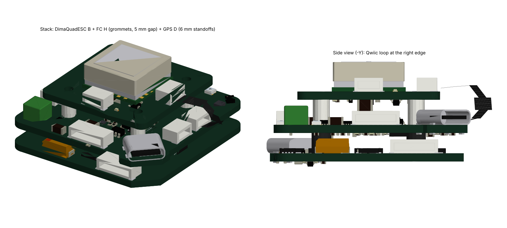

# ACwing – system documents

**Project:** ACwing · **Author:** Andrea Cirillo · **Overview:** [repository README](../../Readme.md)

Documents that concern the whole drone rather than one board: the interface between the electronics and the frame,
and the stack check of the boards with all connectors mated.

| File | What |
|---|---|
| [`ACwing_mechanical_handoff.md`](ACwing_mechanical_handoff.md) | electronics → frame handoff: hole patterns, stack heights, board outlines, connectors, cables, keep-outs (rev E, updated through FC H / ESC 1S B / GPS D) |
| [`ACwing_frame_C2_mechanical_answer.md`](ACwing_frame_C2_mechanical_answer.md) | frame C2 answer: stack hardware, cables wire by wire, flow board mounting, vibration, weight budget |
| [`ACwing_frame_C2_electronics_reply.md`](ACwing_frame_C2_electronics_reply.md) | electronics reply: checks confirmed, non-magnetic stack screws requested |
| `ACwing_stack_check.html` + `stack_data.js` | interactive 3D stack check (ESC 1S B + FC H + GPS D, 6 mm FC → GPS gap): download both files and open the page in a browser |
| `ACwing_stack_3D.png` | render of the stack |

## Baseline configuration (2026-10-19)

The 1S mini drone flies indoor: **ESC 1S rev B + FC rev H + Flow rev A**, no GPS board. The GPS board is the outdoor
extension and can be fitted on the same 20 × 20 stack (6 mm above the FC). Larger drones replace the ESC 1S with
commercial 4-in-1 ESCs on the same FC cable.
