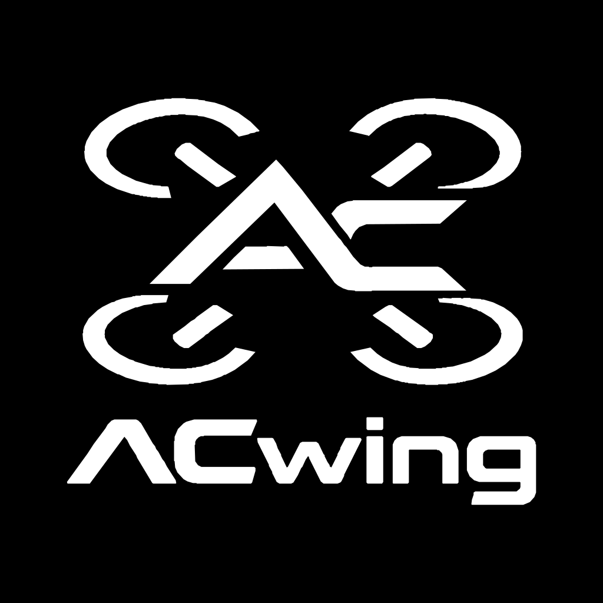
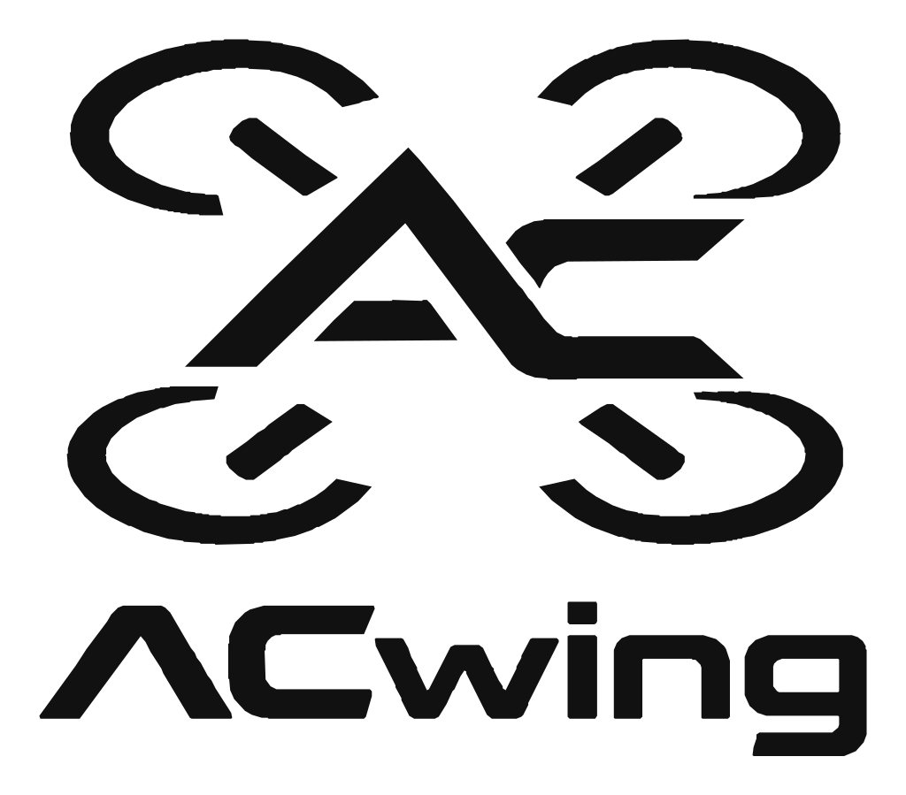

# ACwing – brand files

**Project:** ACwing · **Author:** Andrea Cirillo · **Overview:** [repository README](../../Readme.md)

  
  

All files come from one vector source, `tools/ACwing_reference_vector.svg` (monochrome, even-odd fill).

## Logos
| File | Use |
|---|---|
| `ACwing_logo_black.svg / .png` | full logo (mark + wordmark), black on transparent: light backgrounds, documents |
| `ACwing_logo_white.svg / .png` | full logo, white on transparent: dark backgrounds |
| `ACwing_logo_on_black.svg / .png` | full logo, white on a black square: avatars, covers |
| `ACwing_mark_black.svg / .png`, `ACwing_mark_white.svg / .png` | mark only (drone + "AC" monogram): small spaces, icons |

SVG is the master format (scales without loss); the PNGs are 1024 px wide with transparency. The repository README
uses the black/white PNG pair with a `<picture>` element so GitHub shows the right one in light and dark mode.

## PCB logos
`ACwing_Logo.pretty/` – KiCad footprints of the logo on F.SilkS, filled polygons (holes cut into strips, since KiCad 7
polygons cannot have holes), attribute *board only*, excluded from BoM and pick-and-place:
- `ACwing_Logo_Full_<h>mm` – full logo, h = 4 … 12 mm (aspect 1.154). **Use ≥ 5 mm**: the thinnest stroke is
  0.047 × h, so 5 mm gives 0.23 mm, above the 0.15 mm JLCPCB silkscreen minimum.
- `ACwing_Logo_Mark_<h>mm` – mark only, h = 4 … 12 mm (aspect 1.535), thinnest stroke 0.07 × h.

Place a footprint and flip it (left/right) for the bottom side. The boards copy the sizes they use into their own
project library.

## Silkscreen rules used on the boards
- Logo + board name and revision on each board, the same wording on every board and layer: "FC rev A", "ESC 1S rev A",
  "GPS rev A", "Flow rev A" (the logo already says ACwing). Connector labels on the connector's side, centred on it
  (ESC A/B, GPS, FLOW, ELRS, USB, BAT, TO FC, CHARGE, QWIIC IN/OUT); text 0.8 mm, stroke ≥ 0.15 mm.
- Everything inside the board outline (0.5 mm inset), off pads and courtyards, never overlapping other silkscreen;
  KiCad DRC 0 on all boards.

## Tools (`tools/`)
| Script | What |
|---|---|
| `logo_geom.py` | parses the reference SVG into shapely polygons (mark, wordmark, full) |
| `make_brand.py <out>` | writes the logo SVG/PNG files and the `ACwing_Logo.pretty` library |
| `silk_free.py`, `silk_brand.py <board> <fc\|esc\|gps\|flow>` | free-area search and the branding pass (logos, names, labels) with a DRC check |
| `render_silk.sh`, `pcb_view.py` | silkscreen previews and the PCB views used in the docs |
| `regen.sh` | regenerates Gerber + drill zip, STEP, schematic PDF and DRC report of one board |
| `rename.py` | the project rename to ACwing (file names, libraries, texts, spreadsheet cells) |

Requirements: KiCad 7 (`pcbnew` Python module, `kicad-cli`), Python 3 with shapely, numpy, Pillow, cairosvg, openpyxl.
